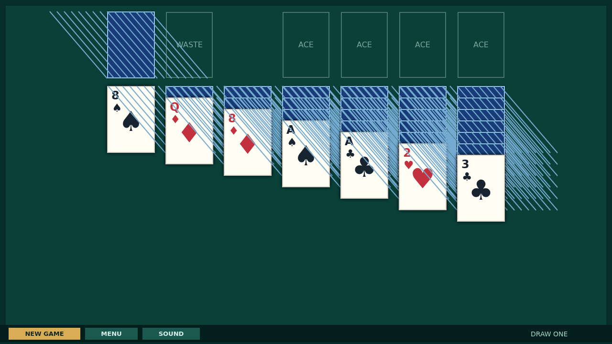
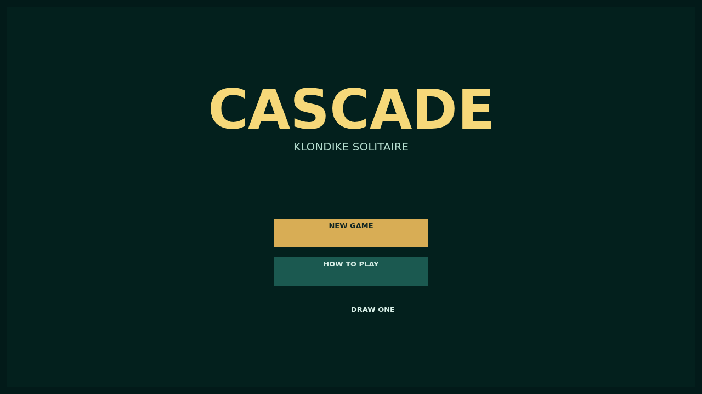

# Cascade

Cascade is a relaxed game of Draw One Klondike on a deep green felt table. Turn the stock one card at a time, uncover the cards tucked into the tableau, and build your four suit foundations from Ace to King.

Every move has a satisfying rhythm: weave alternating red and black runs down the columns, reserve empty columns for Kings, and double-click a ready card to send it home.

Finish the deck and the quiet table erupts. The foundations launch one card after another into a bouncing cascade that paints the felt until the last card disappears from view.

